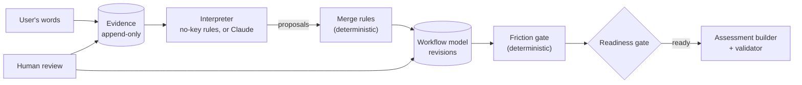

# Ilsa: workflow assessment

A working prototype of an AI-assisted workflow discovery and assessment tool. A business owner describes a process in ordinary language. Ilsa asks one targeted question at a time, maps how the work actually moves, flags friction only where the owner's own words support it, and produces an assessment. The assessment keeps current state, observed friction, unknowns and recommendations separate. Every claim traces back to a quote, a human can correct anything, and recommendations stay locked until the process is understood.

**No API key is needed.** The app, the sample, the tests and the evaluation all run on a deterministic, no-key interpreter. Claude is an optional add-on.

## 60-second demo

`npm install && npm start`, then open http://localhost:3100.

1. **Try the sample (guided).**
   - The first question is "Walk me through what happens…", with a *Why this matters* line.
   - Click **Use sample answer**, then **Answer**. The workflow map fills in, provisional findings appear, and Readiness shows what still blocks: *Recommendations are locked*.
2. **Load finished sample.** The same pipeline has run on the full set of sample answers. A green **Current assessment** appears with four sections.
3. In **Findings**, open F8 *Information loss (S3 → S4)* → **Show evidence**: the owner texts the technician the customer's name.
4. In the map, next to step 4 **How it arrives**, click **Correct**. Enter "The owner assigns it in the spreadsheet and the technician works from there."
   - **What changed** reports: F8 removed · recommendation now traces to F7 only (was F7, F8) · assessment regenerated.
   - The field shows *User changed*, with *Ilsa had: …* underneath.
5. The tentative F9 (*Needs confirmation*) → **Accurate**. It becomes *User confirmed*, and its "Confirm first" recommendation is replaced by an actionable one.
6. **Recommendations:** each has an intervention type, the findings it traces to, and why AI is or is not needed.

Full script: [`docs/DEMO_SCRIPT.md`](docs/DEMO_SCRIPT.md).

## The problem

Owners often know something is going wrong ("we keep losing inquiries") without knowing where the process actually fails. Jumping straight to "buy a CRM" or "add an AI agent" skips the part that matters: who owns each step, how work is handed over, what "done" means, and what happens when the normal path breaks.

## What it does

**Discover → Clarify → Map → Diagnose → Review → Assess → Recommend**

- **Discover:** asks the question that removes the most uncertainty (weight × uncertainty), never "tell me more" about something already settled.
- **Map:** turns answers into a structured workflow. Every fact has one of four certainty states:
  - `known`: stated plainly
  - `inferred`: stated with a hedge like "usually" or "I think"
  - `absent`: the user said it doesn't exist
  - `unknown`: not established

  Every fact carries the exact quote it rests on.
- **Diagnose:** friction from a fixed taxonomy of 16 categories. A finding must cite real quotes linked to the cited steps, and the model must actually show that problem. Findings built on inferred facts are *tentative*.
- **Review:** correct step text, owners and tools; reorder or add steps; mark fields unknown; accept or dispute findings; add context. Every change is a new revision, the evidence log is append-only, and a disputed finding stays disputed unless new evidence supports it.
- **Assess:** locked until every foundational dimension (steps, trigger, ownership, handoffs, exceptions, completion) is established or explicitly unknown.
  - Each recommendation traces to a validated finding.
  - Tentative findings only produce "confirm first" recommendations.
  - AI is recommended only where input genuinely needs interpretation, and only with a stated reason.

## Architecture



**Where AI ends:** an interpreter, whether the no-key rules or Claude, only **proposes**. It reads text and suggests steps, owners, certainty and possible friction. Ordinary code decides everything else:

| Control | Where |
| --- | --- |
| Quotes must be the user's exact words; "known" backed only by hedged words becomes "inferred" | `src/merge.ts`, `src/validate.ts` |
| The opening complaint can't establish facts (capped at inferred) | `src/merge.ts` |
| User corrections can't be overwritten by any interpreter | `src/merge.ts` |
| Next question selection | `src/gaps.ts` |
| Friction must pass taxonomy, quote, linkage and per-category support checks | `src/friction.ts` |
| Readiness gate: no assessment until the process is understood | `src/readiness.ts` |
| Recommendations: fixed catalog, traced to findings, AI only with a reason | `src/recommend.ts`, `src/report.ts` |
| Revisions, append-only evidence, sticky disputes | `src/store.ts`, `src/review.ts` |

Recommendations are never written by a model.

## Run it

Requires **Node.js 24.2 or later**. There's no build step.

```bash
git clone https://github.com/bVan566/ilsa-workflow-assessment.git
cd ilsa-workflow-assessment
npm install
npm start        # http://localhost:3100
```

Data is stored in `data/ilsa.db` (local SQLite, unencrypted). Settings:
- `PORT`, `HOST` (default `127.0.0.1`)
- `ILSA_DATA_DIR`: on Windows, keep the full path under 260 characters

## No key vs. Claude

| | |
| --- | --- |
| **Works with no key** | Everything: discovery, the map, findings, review, assessment, the guided and finished samples, all tests, the evaluation. The header says "No AI service is being called." |
| **What Claude optionally adds** | With `ANTHROPIC_API_KEY` in `.env` (see `.env.example`; model `claude-opus-5-5`, override with `ILSA_MODEL`): better reading of unusual phrasing, and suggested findings the rules can't detect (bottlenecks, duplicate work, inconsistent decisions, customers chasing). Every suggestion passes the same checks. Any failure falls back to the no-key interpreter, and the log says why. |
| **Tested offline** | How Ilsa *handles* Claude's output, using a fake client: request shape, grounding, hedge downgrade, invented quotes dropped, user corrections protected, six failure types falling back, and unsupported suggested findings rejected. |
| **Unmeasured without a live key** | Whether Claude actually reads answers better than the no-key rules, how often its quotes fail the exact-match check, and whether the live API accepts the JSON schema. **No Claude performance is claimed.** |
| **Data sent to Anthropic if enabled** | For every answer or piece of context: that text, the question it answers, and a summary of the current workflow model (steps, owners, tools, facts). For finding suggestions: the model summary plus the quoted evidence linked to each step. Nothing is sent without a key. Don't use real customer data. |

**Cost with a key:** about 2 API calls per answer (interpret + suggest findings), so a full guided session is roughly 25–30 calls. **Load finished sample** always uses the no-key interpreter and costs nothing.

## Tests

```bash
npm test         # 100 tests, offline, no key
npm run typecheck
```

The tests cover:
- schema and evidence validation, persistence, revisions
- discovery: the four certainty states, question selection, termination
- merge rules against fabricating and overconfident interpreters
- friction rules and the gate, including the unsupported-diagnosis failure from five angles
- the readiness gate, the four-section report, the recommendation rules and the report validator
- human review: corrections, sticky disputes, lineage, stale reports
- the Claude interpreter and proposer with a fake client
- the HTTP API and both samples

## Evaluation

Protocol and limits: [`eval/README.md`](eval/README.md). Every result and every miss: [`eval/results/eval.md`](eval/results/eval.md). Reproduce with `npm run eval`.

- **Cases:** 20 hand-written workflows from 20 different businesses (16 with friction, 4 healthy). They're separate from the development examples, and were committed before the only run.
- **What's measured:** the **no-key interpreter and deterministic controls only.**

| Metric | Result |
| --- | --- |
| Step extraction recall / precision (walk-through) | 52/59 (88%) / 52/72 (72%) |
| Owner accuracy where the walk-through names the owner | 18/27 (67%) |
| **Redundant questions** ↓ (stated, but not extracted) | 23/37 (62%) |
| Missing foundational dimensions asked about | 104/110 (95%) |
| **Premature assessments** ↓ | 0 of 40 attempts *(guaranteed by the gate)* |
| Friction recall, categories the no-key rules can detect | 37/61 (61%) |
| Friction recall, categories only Claude could propose | 0/8 |
| **Unlabeled-finding rate** ↓ | 41/85 (48%). 28 of these rest on the scripted interviewee's default "I don't know"; the other 13 include genuine false positives |
| **Findings on healthy workflows** ↓ | 9 across 4 healthy cases (5 rest on the scripted "I don't know") |
| **Overclaiming** ↓ (expected tentative, reported confirmed) | 0 of 6 |
| **AI recommended where not warranted** ↓ / missed where warranted | 1 of 13 / 2 of 6 |
| **Correction invariant violations** ↓ | 0 of 2050 checks *(guaranteed by design)* |

**What this shows:**
- The controls hold: no premature assessments, no stale or invalid reports, no disputed or tentative-only findings behind an action.
- **The no-key interpreter is the weak part.** It often misses things users state plainly, and it flags some friction that isn't there.

The cases and labels were written by the rules' author, and 20 cases is a small sample.

## Designed failure cases

| Failure | What happens |
| --- | --- |
| Premature recommendation | A vague complaint, or "just tell me which CRM to buy", gets a discovery question. The assessment stays locked, with explicit blockers. |
| Unsupported diagnosis | A finding with an invented quote, a real but unlinked quote, or a linked quote that doesn't show the problem is rejected. It's kept only in the audit view. |
| Contradictory correction | The user corrects what Ilsa extracted. Findings that lose support disappear, recommendations lose that lineage or disappear, and the assessment regenerates. An outdated report is never shown as current. |
| Model/API unavailable | Any Claude failure falls back to the no-key interpreter. Saved assessments and the sample keep working. |

## Key engineering decisions

- **Interpreters propose; code decides.** The no-key rules and Claude go through the same merge rules and friction gate, so the controls don't depend on which one ran.
- **Evidence is the unit of truth.** Every fact and finding cites exact quotes, and evidence is append-only.
- **Four certainty states, never collapsed.** Hedges become *inferred*, "doesn't exist" is *absent*, "I don't know" is recorded as explicitly unknown, and nothing is assumed.
- **A readiness gate, not a confidence score.** Recommendations unlock on explicit criteria, and the blockers are listed.
- **Recommendations come from a fixed catalog that prefers the smallest fix,** and every entry says why AI isn't needed. AI is offered only for free-form intake, with a stated reason.
- **Small stack:** Node's built-in `node:sqlite`, `node:http` and `node:test`, and a no-framework UI. The only runtime dependency is the Anthropic SDK, used only when a key is set.

## Known issues

Found in the evaluation and review; see [`eval/results/eval.md`](eval/results/eval.md).

**Issues with the no-key interpreter:**
- **It can create steps from the opening complaint** (6 of 20 cases). Facts from the complaint are capped at inferred, but steps aren't.
- **Customer actions get extracted as steps** ("Clients call…", "Tenants text…"): 7 cases.
- **It often misses stated triggers, completion conditions and owners,** so Ilsa asks again (62% redundant questions).
- **A few verbs are missing** ("inspects", "counts", "moves", "delivers"), and owners after an opening phrase are missed ("After the tour, Nora…").
- **Long free-text owner answers aren't understood** ("Nobody, the helpdesk system does it automatically."), which blocked 1 of 20 cases.

**False positives and restraint:**
- **Waiting is flagged even when it's handled well** (automatic reminders).
- **"paper calendar" is read as two tools,** which triggers a false tool-switching finding.
- **"we" as a step owner counts as unclear ownership.** That's debatable.

**Other gaps:**
- **Handoffs are only explored between steps whose owners are known and different.** Handoffs next to unknown owners are never asked about.
- **The AI-or-not decision is a word check on the trigger.** It missed "Tenants text…" and "call the front desk", and over-fired on phone bookings.

**Scope limits of the prototype:**
- no delete for assessments or data
- no login (it binds to localhost)
- edits use browser prompt dialogs
- the UI has no automated browser tests (it was verified by hand)

## Author

**Billy VanVorst**
Applied AI Systems & Automation
Founder, bVan! Systems

MIT licensed. See [LICENSE](LICENSE).
